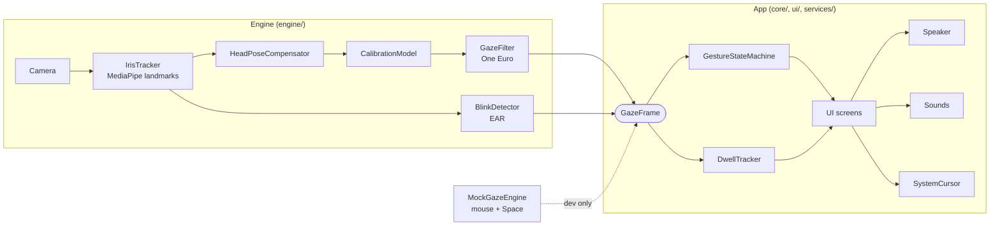

# Architecture

## The big picture

IrisFlow is split into two halves that only talk through one small contract.



## The contract (`src/irisflow/shared/`)

| Type | Direction | Purpose |
|------|-----------|---------|
| `GazeFrame` | engine -> app | One per camera frame: gaze point (screen px), `eyes_closed`, `face_found`, raw `eye_feature`, `confidence` |
| `CalibrationSample` | app -> engine | (target on screen, eye feature) pair collected by the calibration screen |
| `CalibrationResult` | engine -> app | Success flag + mean error in pixels |
| `GazeEngine` | protocol | `start`, `stop`, `read`, `calibrate`, `set_low_power` |

Two key decisions:

1. **The engine reports raw eye state, the app measures time.** `eyes_closed` is a per-frame
   boolean. Whether a closure was a reflex blink, a click or a "go to settings" hold is decided
   in `core/state_machine.py`. This keeps all the gesture rules in one testable place.
2. **The app polls, the engine runs on its own thread.** The UI calls `engine.read()` from a
   ~30 Hz timer and always gets the latest frame. A slow camera never freezes the UI and a slow
   UI never builds up a backlog of old frames.

## Dependency rules

```
ui ──> core ──> shared <── engine
 │               ▲
 └──> services   │
                 └── predict (standalone)
```

- `engine/` imports only `shared/` (and numpy/OpenCV/MediaPipe). Never Qt.
- `core/` is pure Python. No Qt, no engine. Unit-test it with hand-made `GazeFrame` lists.
- `ui/` and `services/` never import from `engine/`.
- Only `app.py` knows which concrete engine is used.

## Timestamps

Always use `GazeFrame.timestamp` (`time.monotonic()` from the moment the frame was captured)
for timing logic, never `time.time()` at processing time. This makes the state machine
deterministic in tests and immune to processing lag.

## Accuracy expectations

Webcam iris tracking is typically accurate to roughly 2-4 degrees of visual angle, which is
several centimetres on a laptop screen. The UI is designed around that: big targets, few of
them, generous spacing. Do not design UI that needs pixel-precise gaze.
